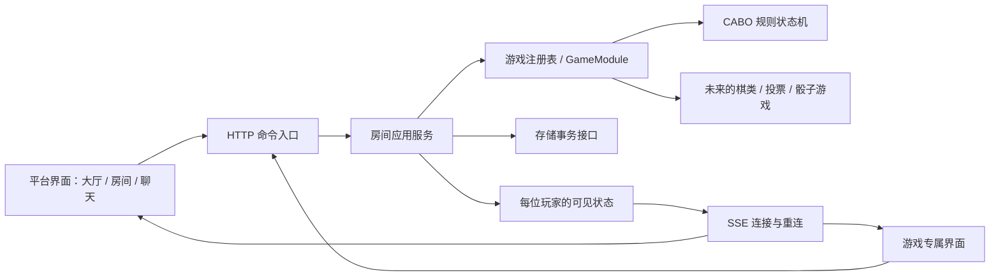

# 架构设计

## 选择模块化单体

当前由一个 Node 进程承载平台，浏览器使用原生模块。先把依赖边界固定，再依据实际负载拆部署单元。新游戏不会要求复制一套房间服务，也不用现在引入微服务、消息队列和一套通用卡牌继承体系。

## 各层负责什么

| 模块 | 负责 | 不承担 |
| --- | --- | --- |
| platform | 会话身份、成员、房主、准备、房间生命周期、动作并发、聊天和持久化协调 | 卡牌数值、回合顺序、棋盘规则 |
| games/* | 游戏状态、合法行动、结束判定、计分、按玩家可见信息 | HTTP、Cookie、文件、聊天与 DOM |
| server | 网络边界、路由、请求大小/基本频率限制、静态资源、SSE | 决定哪个游戏行动合法 |
| web 平台壳 | 入座、创建/加入房间、准备、连接提示、聊天 | 用客户端规则替代服务器校验 |
| web/games/* | 当前游戏的展示、选择、命令生成 | 访问权威暗牌状态或直接改服务器状态 |

`RoomService` 注入 `registry` 和 `store`；它不导入 CABO。客户端单独注册游戏渲染器，游戏模块可以使用自己的棋盘、卡牌或投票控件，不强迫所有游戏共享一个复杂渲染组件。

## 游戏插件契约

`GameModule<State, Command, View, Options>` 定义在 `packages/platform/game-contract.d.ts`。

- `manifest` 提供唯一标识、人数、规则版本与状态版本。
- `create` 创建状态并验证选项；可注入随机数。
- `apply` 对一个玩家命令生成新状态；所有规则与权限由游戏校验，失败抛出领域错误，不修改输入。
- `view` 返回该玩家可以看到的字段白名单；它是安全边界。
- `view` 可读取本次已提交动作的临时上下文，产生经过筛选的动画提示。平台不解释其内容，客户端动画也不能触发或修改规则状态。
- `isFinished` 告知平台整场结束，不是每小轮结束。
- 可选 `bot.observe` / `bot.decide` 根据自己的 `view` 和临时记忆生成命令。通用调度器 `platform/bots.js` 负责延迟和重启恢复，经过 `RoomService` 的同一版本校验与持久化入口执行，不导入具体游戏规则。

状态必须 JSON 可序列化。当前接口是同步的；网络访问不应放在规则函数内。CABO 的 `phase`、`turn`、牌堆、计分等均为其私有状态，不进入平台契约。测试中另一个“同时投票”游戏允许任意顺序提交，用来验证平台没有隐藏的轮流行动假设。

## 房间和对局生命周期

房间固定选择一个游戏及其选项。等待中可加入、离开和准备；房主只有在人数满足且全员准备后才能创建一场游戏。游戏模块自行管理多轮；终局后回到等待状态可以重新准备再开一局。当前房间最多保留一场活动/刚结束对局，再开会替换它，未实现历史对局检索。

进行中的成员集合保持稳定，不把断线直接等同于离场。将来托管、投票解散、弃权必须定义游戏级后果，再由平台调度，不能简单移除数组元素破坏规则。

## 命令与同步

命令走 HTTP POST，快照走 SSE。二者职责独立，以后可以替换为 WebSocket，而不改规则引擎。SSE 断线会重连并得到最新完整快照，无需客户端重放完整事件流。

每个影响房间/游戏的命令携带 `revision`。服务器在同一同步存储事务里检查版本、验证、计算和写入；相同旧版本的并发命令最多一个成功，其余收到 409。客户端刷新后由玩家重新判断，不自动重放。聊天不改变游戏版本，避免聊天导致玩家行动冲突。当前版本校验也避免同一旧命令被重复应用，但没有跨版本的幂等命令标识，也没有事件溯源。

## 信息隔离

服务器保留所有牌；HTTP 与 SSE 一律调用 `game.view(state, viewerId)`，不发送完整状态再靠 CSS 隐藏。暗牌只返回当前牌位和公开状态，不使用可跟踪跨玩家交换的永久卡牌 ID。初始查看与特殊查看确认后，后续快照不再携带秘密；已传给本人浏览器的信息无法“撤回”，这是本地客户端能力边界。

匿名会话 token 使用随机 256 位值、HttpOnly/SameSite Cookie；磁盘仅保存 token 哈希。隐藏状态及私密游戏资料仍以明文写入本地存档，应只让服务进程访问。仓库忽略该目录。聊天作为文本渲染，限制 500 字与最近 100 条；无 HTML 执行。

## 持久化与演进

JsonStore 先克隆数据，对副本运行事务，再写临时文件并重命名，成功后替换内存。它避免应用级失败留下半个回合，但没有跨进程锁或 fsync 级断电保障。不要将同一文件交给多实例使用。

需求出现时按边界替换：

1. 数据增多时换 SQLite/PostgreSQL，做每房间事务与版本条件更新，增加会话过期和房间清理。
2. 多实例时引入原子事务、跨节点广播、连接路由；不能只把 JSON 换到共享盘。
3. 定时器驱动的游戏增加持久化 deadline 和可重放超时命令，不在规则函数内部开 timer。
4. 排位/复盘需求增加独立 Match 记录及带脱敏策略的事件日志；只存随机种子不足以安全公开隐藏信息。
5. 账户需求增加账户—会话映射、退出/撤销与跨设备恢复；新身份不要继承昵称相同玩家的座位。

这些是明确预留的扩展点，不是本版已实现的能力。

## 大厅与房间生命周期界面

大厅使用原型的深青色与暖金色视觉、桌面横幅、加入面板、封面卡片、房间列表和侧栏。CABO 由游戏注册表驱动，其他卡片明确为即将上线。好友、战绩、商城只有入口提示，不伪造好友关系、对局记录或交易。右侧 AI 练习可创建 2–4 人的牌局。公开房间使用服务端实际目录，历史私人房间不会自动被公开。

房间右上角菜单支持保留座位返回大厅、主动退出、房主发起解散。大厅的「我的房间」重新读取当前会话所在房间，恢复保留的座位。退出确认与投票弹窗保持必要的后果提示，重复引导文案已删减。

## 共享界面与布局边界

`apps/web/shell.js` 保留顶部导航节点，只更新选中页签、用户显示和导航下方的页面内容。大厅、等候区、游戏桌共享 `shell.css` 的导航尺寸；游戏样式不得改写公共导航高度。手机保留大厅和我的房间两个页签，其余入口归入更多菜单。

游戏渲染器负责自己的动画队列和内部布局。聊天等无关房间更新不重建游戏桌；同一视口内，抽牌、技能和等待阶段保留相同座位、牌堆和操作区尺寸。CABO 结算以中心覆盖层展示，只读取结算阶段的玩家可见视图，并在每位玩家名下展示最终手牌。
