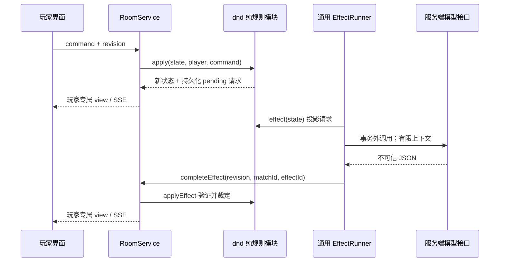

# 雾灯纪行：AI DM 跑团方案与实现

更新于 2026-10-20。游戏 ID 为 `dnd`，显示名为「雾灯纪行 · AI 跑团」。

沉浸玩法、BG3 交互参考、主动掷骰、地图层级、AI 之外的状态管理与扩展验收，见 [沉浸式玩法设计](dnd-experience.md)。

## 产品定位与本次交付

目标是让 1–4 位玩家不用寻找真人 DM，也能在已有平台中完成一次有角色、选择、骰子、战斗和结局的合作冒险。玩家通过房间码相聚，AI 扮演地下城主，服务器执行规则。AI DM 不占玩家座位。单人可直接开局，也可以添加本地策略队友。

本次交付是可运行的完整短篇冒险闭环，不是完整 D&D 虚拟桌面。当前冒险使用 SRD 5.2.1 规则子集和明确的线上简化。完整职业构筑、战棋地图、长期战役的实现路径放在后文，与已实现功能分开列出。

| 环节 | 已实现 |
| --- | --- |
| 开桌 | 大厅卡片、1–4 人房间、准备、邀请、AI 队友、默认不限时 |
| 角色 | 四个简化一级原型、自定义角色名、只对本人展示的背景 |
| DM | 服务端 OpenAI 兼容接口、自由行动裁定、持久故事后果与支线、公开事实问答、真实流式叙述与平滑打字机 |
| 探索 | 三套可选副本；原创四场景 + 黑苹果十场景 + 旧岛要塞九场景；调查、交涉、线索解锁、回访与不同结局 |
| 判定交互 | 属性/熟练拆分、成功率、锁定行动、主动掷骰动画、优势双骰、结果揭晓与取消 |
| 世界界面 | 四幅交互场景、人物/物件热点、紧凑行动栏、队伍生命条；地图/任务/角色/日志按需打开 |
| 战斗 | 先攻、d20 攻击、AC、优势/劣势、重击、伤害、闪避、敌人自动行动 |
| 资源 | HP、一次短休生命骰、药水、牧师/法师一环法术位、死亡豁免与稳定伤势 |
| 结果 | 营救成功或撤离失败、全队共同战绩、平台奖励与再开一局 |
| 可靠性 | 玩家视图、原子版本校验、SSE、刷新重连、待处理 DM 请求重启恢复 |
| 降级 | 无密钥、超时、HTTP 错误、无效 JSON、非法模型行动时可继续；界面标明本地模式 |

## 玩家旅程

1. 大厅选择「雾灯纪行」，选择 AI DM 或本地引导，以及英雄/神秘叙事风格。
2. 邀请朋友，或自己准备并开始。进入游戏后选择守卫、斥候、守灯人、符文学者之一，输入名字和选填背景。
3. DM 描述委托与环境。玩家先在已有房间聊天里讨论，当前行动者提交一句话或选择快捷行动。
4. 自由描述可提出新的做法与技能检定，也可直接执行现有行动。DM 说明成败后果；玩家确认掷骰后，服务器保存规则结果、NPC 关系与承诺等故事变化，必要时出现可继续追踪的支线。问题或目标不明时澄清，不消耗回合。
5. 需要骰子的行动先显示 DC/AC、属性、熟练、优势和资源成本。可以重新选择；确认「掷骰」后服务器保存骰点、伤害/治疗、资源与场景变化，界面播放动画并揭晓结果。随后 DM 依据这些事实叙述。
6. 战斗按先攻轮流，敌人自动行动。非战斗按座位轮流，让每个玩家都能参与。
7. 营救成功或决定撤离后出现终章，自动记入每个人的战绩。关闭浏览器不等于退出；从「我的房间」可继续。主动退出沿用平台的本地 AI 接管。

## 规则与内容依据

锁定 **SRD 5.2.1**，不混用 SRD 5.1 的数值。例如治疗伤口采用一环 `2d8 + 施法属性调整值`。规则来源、页码、每项简化和署名见 [dnd-rules.md](dnd-rules.md)。

规则采用 SRD 明确提供的 CC BY 4.0 内容；雾灯矿井为原创，黑苹果妖丘和旧岛要塞改编自单独的 CC BY-SA 4.0 授权作品，改编内容按同许可发布，来源和具体边界见 [可选冒险](dnd-adventures.md)。场景图为原创，不使用商业模组的原画或地图。D&D Beyond 的免费可阅读内容不能一概当成 SRD 许可内容。官方 SRD 页面及 Creator FAQ 已在 2026-10-20 核对：

- [官方 SRD 下载与授权说明](https://www.dndbeyond.com/srd)
- [SRD 5.2.1 官方 PDF](https://media.dndbeyond.com/compendium-images/srd/5.2/SRD_CC_v5.2.1.pdf)
- [Creator FAQ](https://www.dndbeyond.com/creator-faq)

### 首个剧本：雾灯矿井

| 场景 | 玩家目标 | 分支 |
| --- | --- | --- |
| 渡鸦溪镇 | 接下寻找三位修灯工的委托 | 旧矿图 → 水渠路线；安抚信使 → 口令 |
| 覆苔山径 | 穿过狼群活动的山道 | 水渠绕行；潜行检定；侦查后正面遭遇 |
| 沉钟矿门 | 越过恐惧的守矿人 | 口令游说；研究锁舌；力量推门；制服守矿人 |
| 雾灯之室 | 解除屏障，营救修灯工 | 研究符文后点灯；仪式失败或主动选择会触发最终战斗 |

检定失败不会造成永久死锁。可尝试的不同途径保留，线索检定全队每场景一次，不能靠重复发送同一行为无限刷成功。某个分支的成功不是通关的唯一条件。守矿人战斗的结果定义为制服，避免模型擅自把玩家选择升级为杀人。

## 架构



| 所有者 | 文件 | 职责 |
| --- | --- | --- |
| 游戏规则 | `packages/games/dnd/index.js` | 角色、场景、战斗、纯状态迁移、可见投影、模型提案校验 |
| 规则数据 | `packages/games/dnd/content.js` | 原型、原创剧本、敌人、来源署名 |
| 骰子规则 | `packages/games/dnd/dice.js` | 注入随机数、d20、攻击与伤害计算 |
| 判定与世界投影 | `packages/games/dnd/mechanics.js` | 属性拆分、成功率、已探索地图、当前人物和任务 |
| 游戏 UI | `apps/web/games/dnd/` | 日志、角色卡、行动输入、队伍、线索与结局 |
| 异步调度 | `packages/platform/effects.js` | 并发、超时、待处理请求恢复与提交；不导入任何具体游戏 |
| 事务边界 | `packages/platform/rooms.js` | 内部完成命令的 revision / matchId / effectId 检查与持久化 |
| 模型传输 | `apps/server/ai-provider.js` | HTTP、凭据、响应字节限制、JSON 解析；不决定游戏规则 |

房间、会话、聊天、持久化继续由原模块拥有。没有为新游戏复制房间服务，没有在 `apply` 或 `applyEffect` 内加入网络、定时器或文件操作。新增 `effect/applyEffect` 为可选游戏契约，对现有游戏没有强制要求。

### 两阶段 AI 工作流

自由文字先进行裁定。模型可返回已有 `choiceId`、不消耗回合的 `reply`，或受严格结构约束的 `improvisation`。临时行动分为解决当前障碍、创造一次性环境影响、持久故事变化三类，可携带支线；禁止任意状态补丁、奖励或新地图坐标。非法 ID、技能、目标、额外写入属性与超长回应均不会执行。撤离与让过由玩家通过明确按钮发起。

有效行动由规则模块验证。需要随机数时先创建持久化 `pendingCheck`，等待当前玩家发送 `roll`；`cancelCheck` 重新选择。确认后才消耗资源并投骰，记录 `lastCheck`，然后创建仅负责叙述的请求，只接受 `narration` 字符串。快捷行动跳过意图识别，只需要一次叙述请求。AI 不能通过叙述改变 HP、骰点、背包、任务或胜负；界面始终保留独立的规则日志。

模型提示词本身不能保证文字绝不幻觉，因此 UI 明示规则日志为最终裁定。未来内容量增大时，可给生成文字增加事实一致性评估，但不能让第二个模型成为规则权威。

### 模型上下文与隐私

请求只包含当前公开场景、角色名和公开 HP、已发现线索、当前敌人、最近 10 条非 DM 事件，以及本次合法行动菜单。不会发送会话 Cookie、账号资料、房间聊天、真实玩家昵称、私密背景、未来场景的解法或权威全量状态。

角色名和自由输入本身仍可能包含玩家填写的信息，创建页面已提示它们会发送给部署者选定的模型服务。模型输出与玩家输入都作为纯文本转义后展示，不执行 HTML、Markdown 中的任意代码或工具指令。当前模型没有浏览器、文件、Shell 或平台管理工具。

背景只属于本人；角色公开数值对全队可见。未来“私密 DM 对话”需独立的定向事件和 `viewerId` 投影，不能复用公共叙述后在客户端隐藏。

### 并发、幂等与恢复

- 用户行动先在事务里校验 revision；重复点击或多人同时提交旧版本时只允许一次成功。
- 每个 pending 请求有单调递增 ID。异步任务同时捕获 matchId、revision、stateVersion 和完整请求指纹。
- 模型完成时，在写入事务里再校验 revision / matchId / effectId / 活动状态 / 解散投票状态。
- 如果无关房间变更导致版本过期，调度器重新投影请求。内容完全相同才复用刚取得的结果；变更了内容则重新请求。
- 解散投票暂停结果提交，否决后继续。已删除房间或已换场对局拒绝旧结果。
- pending 保存在已有房间存档内。服务重启会恢复请求；进程崩溃恰好发生在模型返回和存档之间时，可能再次调用模型，不能承诺跨重启恰好一次计费。
- 目前仍是平台的单进程 JSON 存储，一个数据卷不能运行多个实例。扩容应先迁移数据库，再加任务租约和幂等键。

当前游戏状态为 **v4**。v2 新增主动掷骰；v3 新增副本 ID、访问地点与任务标记；v4 新增故事记忆、支线、环境影响与可保存的即兴行动裁定，提供纯 v1/v2/v3→v4 迁移。v3 保留原副本与进度，早期版本归入雾灯矿井；保留角色、资源、日志、骰点及待处理请求。不修改其他游戏的状态结构。后续新增持久化字段或改变结构时，继续提升 `stateVersion` 并提供纯 `migrate`，通过平台启动迁移原子保存。

## 模型部署与费用控制

0.7.0 起可直接使用管理员账号进入「管理中心 → AI DM」填写服务地址、模型和密钥。保存立即影响后续请求，密钥加密保存且不回显，详见 [管理配置](administration.md)。以下环境变量保留为首次后台配置前的兼容方式；后台保存后以后台配置为准。

接口依据 [OpenAI Chat Completions 文档](https://developers.openai.com/api/reference/resources/chat/subresources/completions/methods/create)，为了兼容用户指定网关，使用 JSON mode 加本地严格验证。部署配置：

```powershell
$env:AI_DM_BASE_URL = 'https://api.openlux.ai/v1'
$env:AI_DM_MODEL = 'gpt-6-luna'
# 在服务进程环境中设置 AI_DM_API_KEY，勿提交到仓库。
npm start
```

`AI_DM_API_KEY`、`AI_DM_BASE_URL` 和 `AI_DM_MODEL` 只由服务端读取。密钥或模型未配置时自动本地引导，界面不会假称模型在线。本地引导的自由文本只做有限关键字识别；复杂目标、治疗对象等请使用按钮。

叙述使用 SSE 流式响应，处理方式参考 [官方流式接口说明](https://developers.openai.com/api/docs/guides/streaming-responses)。意图识别仍等待完整响应，规则提交和临时文字呈现分开验证，详情见 [体验设计](dnd-experience.md)。

本地 Docker 和生产 Compose 均转发上述变量。示例见 `deploy/.env.example`。`.env` 已忽略；生产建议用部署系统注入秘密。不要把测试密钥放进镜像、前端代码、规则选项或房间存档。

每个进程最多同时进行 4 个异步模型请求；每个请求最长 25 秒、最多 900 输出 token。普通响应最多 64 KiB；流式封装最多 1 MiB，解码正文最多 64 KiB，投影叙述最多 1200 字。请求不自动重试。一个对局最多使用前 320 个 effect 请求调用模型，此后本地接续；最多执行 160 次实质行动，达到上限触发黎明撤离。日志只保留最近 100 条，当前剧本不提供完整战报导出。

管理员可以在 AI DM 设置中调整上下文预算（默认 100k）、温度（可留空采用模型默认值）与独立的 DM 风格提示词。模型可在预算内接收保存的公开日志与故事变化，不再只依赖最近十条规则摘要；必要局势与规则优先，旧记录按整条裁剪。具体估算、迁移与服务商窗口边界见 [管理配置](administration.md#上下文温度与-dm-风格)。

未读取或假设网关价格。实际费用取决于网关的输入/输出计费：按钮行动约一次模型请求，自由行动通常两次，纯问答一次。当前 `store: false` 是发送给兼容服务的参数，不代表对第三方的数据保留策略作保证。大量公开运营前应补充按账号日配额、预算熔断、管理员用量面板和网关告警。

### 故障行为

| 故障 | 玩家看到的行为 |
| --- | --- |
| 无密钥或明确本地模式 | 本地引导，不发出模型请求 |
| 429/5xx/超时/网络断开 | 该请求本地接续；下一次行动可再次尝试模型 |
| 无效或截断 JSON | 不执行任意字段；按请求类型澄清或使用本地叙述 |
| 模型选择不存在的动作 | 保持规则状态与回合，要求说明具体意图 |
| 玩家请求旧版本 | 409，界面按已有平台逻辑刷新 |
| 服务器重启 | 恢复存档；继续 pending，身份和角色不丢失 |

## 测试与验收

`npm test` 包含以下新增覆盖：

- `tests/dnd.test.js`：规则边界、不变性、玩家投影、完整谈判通关、恶意提案、资源、重击、死亡豁免、投骰前不取随机数、取消与权限、成功率、迷雾与 v1→v2 迁移，以及 35 组固定种子的一至四人冒险。
- `tests/effects.test.js`：去重、事务版本检查、同请求结果复用、投票暂停、超时、重启、删除房间和变更任务的迟到结果。
- `tests/ai-provider.test.js`：配置与请求格式、HTTP 失败、响应过大、截断、拒绝和无效对象。
- 流式补充覆盖：逐字节中文/UTF-8、JSON 转义、残缺流拒绝、片段不落存档、逐玩家投影、过期请求拒绝、真实 SSE 增量与重连，以及最终保存时保留打字机进度。
- `tests/dnd-http.test.js`：真实 HTTP/SSE、权限、两名玩家私密背景隔离、禁止伪造系统完成命令、待处理请求恢复、共同战绩归档与静态资源。

浏览器验收应覆盖大厅开房、单人开局、角色创建、真实 AI 开场、自由文字→检定→叙述、快捷行动、刷新恢复、规则展开和结束再开。测试生成的房间、浏览器截图及联调脚本均放在被忽略的 `work/`。生产密钥不进入测试夹具。

## 后续完整产品的扩展路径

| 阶段 | 实现内容 | 验收条件 |
| --- | --- | --- |
| 当前版本 | 短篇原创剧本、四个简化原型、服务器规则与 AI 叙述、主动骰子、判定拆分、路线图与状态面板 | 不配模型也能完整通关；模型无法越权改状态；投骰先保存再呈现 |
| 规则扩充 | 一级至五级完整 SRD 职业、合法构筑、装备、法术目标、豁免、状态、专注、附赠动作与反应 | 每个能力有来源锚点、测试和角色创建校验；存档迁移成功 |
| 战棋遭遇 | 网格/区域位置、移动预算、射程、掩体、视线、机会攻击、战术 AI | 客户端不能越距攻击；隐藏单位按玩家投影 |
| 开放剧本 | 有版本的内容包、NPC 目标和关系、任务图、道具白名单、分支编辑器 | 模型只能引用已授权且当前可见的内容 ID；失败路线可达 |
| 长期战役 | 独立 Campaign / Session / Character / Event 数据、升级、战利品、休整、章节摘要、导出 | 多次会话恢复不靠全量聊天；迁移和回放重建一致 |
| 运营规模 | SQLite/PostgreSQL、事务任务表、任务租约、预算配额、人工 DM 接管、异常监控 | 多实例下只落库一次；用户可看到失败原因和恢复操作 |
| 沉浸增强 | 可选语音、交互场景与角色立绘、法术效果、主持节奏与个人剧情 | 声音/图片不会包含未公开情报；文本模式保持完整可用 |

### 内容与规则检索的建议结构

内容扩充时，把 SRD 条目转换成有稳定 ID 的 `Rule / Spell / Item / Monster` 数据，每条记录包含 `edition: SRD-5.2.1`、原文页码、许可、修改说明和已实现标记。冒险包仅引用这些 ID。

检索先按版本、当前权限和能力白名单筛选，再做全文/向量检索。检索只为模型提供解释依据，不允许检索到的文字自动成为新命令。未来的工具接口可扩展为 `request_check / attack / cast_spell / use_item / move / talk_to_npc`，参数仍由服务器验证目标、时机、资源和范围。现在的 `choiceId` 是这一受限工具协议的首个实现。

长期记忆分为结构化事实（角色、任务、NPC 关系、公开世界状态）、经玩家权限过滤的事件，以及可重建的文字摘要。摘要不覆盖规则事实；秘密与公开记忆分别保存。内容包升级也需要版本号与迁移策略，避免同一存档中途换版。
